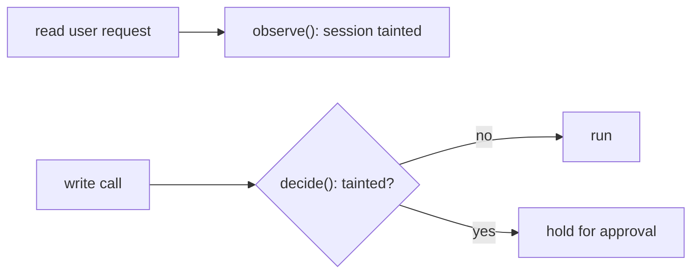

# Spec: Explain, so the developer always understands what the agent did

Status: a slim version is implemented in 0.12.0 (2026-11-11), agreed with the user: on demand (`/explain`), no gates, local only. Not built: the Stop and commit gates, comprehension checks and understanding debt, the developer profile and its adaptation, MAP.md, TIMELINE.md, roll-ups, the post-commit hook. What was built and the live results: docs/PLAN.md item 13. Language of all templates and generated text: English.

## 1. The problem and the promise

After a few hours of agentic work, developers own code they did not write and cannot fully explain ("comprehension debt"). Explain makes the workspace keep the developer in the loop: every meaningful change comes with a short, grounded explanation written for *this* developer, plus a living map of the codebase and a quick check that the explanation landed.

What the workspace **guarantees**, and what it only **measures**:

| Property | Level | Mechanism |
|---|---|---|
| Every verified unit of work and every commit has an explanation | **Guaranteed** | Gate on Stop and on commit (section 8) |
| Every factual claim points at real evidence (a file:line in the diff, a command that ran) | **Guaranteed** | Deterministic validator (section 7) |
| The explanation follows the readability rules | **Guaranteed** for the rules a program can check; the rest by template | Validator + template (sections 3, 7) |
| The developer understood it | **Measured, not guaranteed** | Comprehension checks and a visible "understanding debt" counter (section 9) |

Never market the last row as a guarantee.

## 2. Decisions taken

| # | Decision |
|---|---|
| E1 | Triggers: **per verified unit of work** and **per commit**. A commit gets a roll-up that links its units; nothing is explained twice |
| E2 | Audience: **adapted to the developer** through a short profile asked at install, refined by check results |
| E3 | Storage: **local only**, `.claude/explain/`, gitignored through the installer's managed `.gitignore` block |
| E4 | Comprehension checks: **on for every unit**, non-blocking by default, blocking only for critical paths |
| E5 | Language: **English** |
| E6 | Facts are captured by code, never recalled by the model. The model only explains facts it was given |

## 3. Writing rules: "a colleague at the whiteboard"

The target reader is a busy engineer who did not watch the session. Seniors want it **fast and precise**; juniors want it **unambiguous**. The same rules serve both: plain words, concrete facts, nothing padded. Depth changes with the profile; clarity does not.

**Structure: most important first.**
1. **In short**: at most 3 sentences, at most 60 words. What changed and why it matters. Someone who reads only this should be able to say what happened.
2. **What changed**: grouped by *purpose*, not by file. Each item: one line, with its evidence.
3. **Why**: the request and the decisions that led here, in the user's own words where possible.
4. **How it works now**: one diagram at most, plus up to 5 numbered steps.
5. **Not done / not tested**: always present, even if the answer is "nothing known".
6. **Verify yourself**: exact commands, copy-pasteable.
7. **Start reading at**: one file:line, the best entry point.
8. **Details**: anything else goes inside `<details>` so it never gets in the way.

**Sentences.**
- One idea per sentence; at most 25 words. Active voice: "the guard holds the write", not "the write is held by the guard".
- Name things concretely: "`decide()` in decide.cpp:41", not "the decision logic".
- Define a term the first time it appears, in a clause: "taint (a flag meaning the agent has read untrusted text)". Terms defined once go to the map's glossary.
- Numbers instead of adjectives: "4 new tests, all pass" instead of "comprehensive tests".
- An example beats an abstraction: show one input and its output when behaviour changed.
- Analogies only when the mechanism is unfamiliar to this developer's profile, and never instead of the precise statement.

**Banned** (the validator flags them): "robust", "seamless(ly)", "leverage", "comprehensive", "various", "enhance(d)", "streamline", "it should be noted", "in order to", "as mentioned", marketing tone, apologies, and any claim of testing without a recorded command.

**Before / after example of the rules:**

> ❌ *Implemented a robust and comprehensive taint-tracking mechanism to enhance the security posture of write operations across various tools.*
>
> ✅ *Writes now wait for approval if the agent has read an end-user request earlier in the session. `observe()` marks the session (taint.cpp:12), and `decide()` checks the mark before any write (decide.cpp:41).*

## 4. Concepts

**Unit of work.** A unit closes at a `Stop` event when both are true:
- source files changed since the previous unit (per git, excluding `.claude/`), and
- at least one verification command (test, build, lint, or a command listed in the profile) **succeeded after the last edit**.

If files changed but nothing was verified, the unit stays open; the status line shows `explain: 1 unverified change`. The agent can also close a unit explicitly with `/explain` (marked "closed manually, not verified").

**Commit.** Any commit, whether made by the agent (observed via the Bash tool) or by hand (recorded by a `post-commit` git hook that only appends the hash to a queue; the roll-up is written at the next session start).

**Critical paths.** Globs in `.claude/workspace/explain.json` (e.g. `guard-core/**`, `src/auth/**`). Changes there get a blocking check (section 9).

## 5. Captured facts (no LLM)

At every unit close, workspace-core writes a **change record**, `.claude/explain/records/<unit-id>.json`, from data it already observes or can read:

```jsonc
{
  "unit": "u-0007",
  "closedAt": "2026-11-20T14:32:10+03:00",
  "closedBy": "verified",                    // or "manual"
  "request": "block writes after reading user requests",  // first user prompt of the unit, trimmed
  "files": [{ "path": "guard-core/src/decide.cpp", "added": 38, "removed": 4, "hunks": [[41, 78]] }],
  "commands": [{ "cmd": "ctest -R matrix", "exit": 0, "at": "…" }],
  "skills": ["superpowers:test-driven-development"],
  "decisions": ["D5"],                        // new or changed headings in .claude/memory/decisions.md
  "structural": true,                        // new module, new dependency, moved file, new public API
  "critical": true                           // touched a critical glob
}
```

`structural` is computed by rules: a new top-level directory or package, a manifest change (`package.json`, `CMakeLists.txt`, `Cargo.toml`, …), a renamed or moved file, or a new exported symbol where the language is supported.

## 6. Outputs

All under `.claude/explain/`, gitignored:

| File | What it is | Updated |
|---|---|---|
| `units/u-0007.md` | The unit explanation (template 6.1) | At unit close |
| `commits/<short-hash>.md` | The commit roll-up (template 6.2) | After each commit |
| `MAP.md` | Living overview of the codebase (template 6.3) | Only when a unit is `structural` |
| `TIMELINE.md` | One line per unit and commit, newest at the bottom | Every unit and commit |
| `records/*.json` | Captured facts (section 5) | At unit close |
| `checks.json` | Questions, answers, results | Per unit |

The agent shows the developer the **In short** section and the checks in the chat, with the file path for the rest. The full explanation is never pasted into the chat.

### 6.1 Unit explanation template

```md
# u-0007 · Guard Core: writes after untrusted input now need approval
<!-- unit u-0007 · verified · 2026-11-20 14:32 · profile: depth=standard -->

**In short:** Writes now wait for approval if the agent has read an end-user request earlier in the session. Before this, an injected request could make the agent disable protection for every tenant.

## What changed
- **Decision rule:** two new branches for tainted sessions → `guard-core/src/decide.cpp:41-78`
- **Taint source recorded:** `observe()` now stores which field was untrusted → `guard-core/src/taint.cpp:12-30`
- **Tests:** 4 new matrix cases, all pass → `guard-core/tests/matrix_test.cpp` · ran `ctest -R matrix` (exit 0)

## Why
You asked to "block writes after reading user requests". This follows decision D5: rules decide, the LLM only explains.

## How it works now

1. A read returns end-user text, so `observe()` marks the session.
2. A later write asks `decide()`, which sees the mark.
3. The write is held; the technician approves or rejects it in the Console.

## Not done / not tested
- Behaviour when guard-core is slow under load (timeout path) is not tested.

## Verify yourself
```sh
ctest -R matrix
echo '{"op":"decide","session":"s1","action":{"tool":"update_policy","kind":"write","tenants":"all","changes":[]}}' | ./guard-core
```

## Start reading at
`guard-core/src/decide.cpp:41`

<details><summary>Details</summary>
…anything else: alternatives considered, edge cases, follow-ups…
</details>
```

### 6.2 Commit roll-up template

```md
# a1b2c3d · Hold tainted writes for approval
**In short:** ≤2 sentences.
**Units in this commit:** [u-0006](../units/u-0006.md) · [u-0007](../units/u-0007.md)
**Not covered by those units:** anything in the commit diff that no unit explains (or "nothing").
**Risk to watch:** one line, or "none known".
```

### 6.3 MAP.md template

```md
# Codebase map
<!-- updated by u-0007 · 2026-11-20 -->

## The system in one paragraph
## Components
```mermaid
flowchart …   (C2-style: one box per component, one arrow per real dependency)
```
| Component | Lives in | Does | Talks to |
## Where to find…
- "the allow/hold decision" → guard-core/src/decide.cpp
## Glossary
- **taint**: a flag meaning the agent has read untrusted text in this session.
## Recent structural changes
- u-0007: added observe() taint sources
```

### 6.4 TIMELINE.md line

```md
- 2026-11-20 14:32 · [u-0007](units/u-0007.md) · Guard Core: writes after untrusted input now need approval · ✅ checked
```

## 7. Validator (deterministic, runs before the gate passes)

| Rule | Check | On failure |
|---|---|---|
| Structure | All required sections present, in order; **In short** ≤3 sentences and ≤60 words | Agent fixes |
| Grounding: files | Every `path:line` or `path:a-b` cited exists **and** overlaps a hunk in the record (or is marked `(context)`) | Agent fixes |
| Grounding: commands | Every command claimed to have run appears in `records.commands` with that exit code | Agent fixes |
| Coverage | Every changed file in the record is cited at least once, or listed under "Details: also touched" | Agent fixes |
| Honesty | "Not done / not tested" present; no "tested"/"passes" wording without a recorded command | Agent fixes |
| Readability | No banned phrases; no sentence over 35 words outside code; every backticked identifier introduced with a file:line once | Agent fixes |
| Diagrams | At most one per unit; every Mermaid block parses (`mmdc` if installed, else a syntax check) | Agent fixes |
| Length | Unit file ≤ the profile's budget (section 10) excluding `<details>` | Agent shortens |

Grounding is mechanical: it proves the explanation points at the right places, not that its reasoning is correct. That limit is stated in the README.

## 8. Gates and integration

**Stop gate (unit close).** When a unit closes and `units/<id>.md` is missing or fails the validator, the Stop hook blocks with a short reason listing the failed rules. After **2 failed attempts** the gate releases (same policy as the existing debug gate), records the unit as `unexplained`, and adds it to the understanding debt. The workspace never traps the developer.

**Commit gate.**
- Before an agent-made `git commit` (PreToolUse on Bash): every unit since the last commit must be explained. Critical-path units must also have their check answered (section 9).
- After the commit (PostToolUse): write the roll-up. For hand-made commits, the queued roll-up is written at the next session start.

**md-memory.** session.md is for the next agent; Explain is for the human. They share the same record: the session.md handoff block links the latest unit explanation instead of repeating it.

**Contracts and skills.** No new contract class. Explain is triggered by events, not by request classification, so the English-only classifier does not matter here.

**CLAUDE.workspace.md.** Add a short section, included when Explain is installed:
```md
## Explain
- When a unit of work closes, write `.claude/explain/units/<id>.md` from the change record, following the template and writing rules in `.claude/workspace/explain-template.md`. Show the developer only the "In short" section and the checks.
```
The full template and writing rules live in a separate owned file that is read only when writing an explanation, so they cost no tokens in normal turns.

## 9. Comprehension checks and understanding debt

**Questions.** With each unit explanation the agent writes 2 questions (3 for critical paths) into `checks.json`. Rules:
- Each question is about **behaviour or a consequence**, never trivia ("what happens to a single-tenant write after a tainted read?", not "what line is decide() on?").
- Each has a reference answer that cites the code.
- Answerable in one sentence.

**Asking.** At the end of the turn that closes the unit, the agent shows the In short section and the questions. The developer answers in plain text, or types `skip`.

**Grading.** The model compares the answer to the reference answer: `understood`, `partly` or `missed`. This grading is an LLM judgment, so it is labelled as such in `checks.json`; it informs, it never blocks on its own. For `partly` or `missed`, the agent gives a 2–4 sentence follow-up on exactly that point and asks once more.

**Understanding debt.** A unit is in debt while its check is unanswered, skipped or missed after the follow-up.
- Shown in the status line: `understanding: 3 changes unreviewed`.
- `claude-workspace explain status` lists them with links.
- `/explain check` replays the open checks.
- **Critical paths:** an agent-made commit is blocked until their checks are answered (any grade). Answering is required; being right is not, because the follow-up does the teaching.

## 10. Developer profile

**Asked once at install** (interactive installs only; `--yes` writes the neutral default). Six questions, about a minute:

| # | Question | Options | Stored as |
|---|---|---|---|
| 1 | How would you describe your experience? | junior · mid · senior · staff+ | `experience` |
| 2 | For each language detected in this repo: how comfortable are you? | new · working · fluent | `languages{}` |
| 3 | How familiar are you with this project's domain? | new · some · expert (free-text domain name) | `domain` |
| 4 | How much do you want per change? | short · standard · detailed | `depth` |
| 5 | Diagrams? | always · structural changes only · never | `diagrams` |
| 6 | Which commands count as verification here? | detected test/build commands, editable | `verify[]` |

Stored in `.claude/workspace/profile.json` (gitignored). `claude-workspace profile` re-asks.

**What the profile changes.** Clarity rules never change; depth does:

| Knob | short | standard | detailed |
|---|---|---|---|
| Unit length budget (outside `<details>`) | 150 words | 300 words | 500 words |
| "How it works now" steps | 0–3 | up to 5 | up to 8 + one example input/output |
| Terms defined inline | only new to this project | + those outside the developer's fluent languages | all non-obvious terms |
| Analogies | never | when the domain is "new" | when helpful |

**Adaptation from checks.** If a developer misses 2 of the last 3 checks touching one area (a top-level directory or a language), Explain raises depth one step for that area only and notes it in the profile (`overrides`). Two consecutive `understood` results there lower it back. The developer can see and reset overrides with `claude-workspace profile`.

## 11. Commands and switches

| Command | Does |
|---|---|
| `/explain` | Explain the current uncommitted changes now (closes a unit manually) |
| `/explain map` | Show MAP.md's summary and diagram; regenerate if stale |
| `/explain check` | Replay open checks |
| `/explain last` | Show the last unit's In short section and its file path |
| `claude-workspace explain status` | Debt, open units, last map update |
| `claude-workspace profile` | Re-run the profile questions; show overrides |

| Switch | Effect |
|---|---|
| `CW_EXPLAIN=0` | Turn Explain off (capture included) |
| `CW_EXPLAIN_GATE=0` | Keep explanations, never block |
| `CW_EXPLAIN_CHECKS=0` | No comprehension checks |
| `.claude/workspace/explain.json` | Critical globs, per-path overrides |

## 12. Observability

New events in the existing JSONL log: `explain.unit.closed`, `explain.written`, `explain.validator` (rules passed/failed), `explain.gate` (blocked/released), `explain.check` (asked/answered/grade), `explain.map.updated`, `explain.debt` (count). The Workspace Usage footer adds one verified line, e.g. `explain: u-0007 written · validator 8/8 · check answered (understood)`.

## 13. Cost and limits

- Each unit explanation is one extra model turn, roughly 1–3K output tokens; checks add a little. Units close only on verified changes, so a typical session sees a handful, not dozens.
- The template and writing rules are read only when writing an explanation, not loaded every turn.
- Grounding proves location, not correctness. Checks measure understanding with an LLM grader; both limits are stated plainly.
- Local only: teammates do not see the explanations. A future `--share` could copy roll-ups into PR descriptions.

## 14. Rollout

| Phase | Scope | Proves |
|---|---|---|
| A (during the hackathon, no workspace change) | Use the 6.1 template by hand: ask "explain the last unit using this template" after a few units of Agent Bridge | Which sections you actually read |
| B | Change records + `/explain` + validator, no gate | Grounding works; explanations are short enough |
| C | Stop and commit gates, roll-ups, TIMELINE | The guarantee holds without trapping the developer |
| D | Comprehension checks + understanding debt | People answer them; follow-ups help |
| E | MAP.md + profile adaptation | The map stays accurate; depth adjusts sensibly |

## 15. Tests and acceptance

**Automated:** unit-boundary rules (changed + verified-after-edit); record capture; every validator rule with a passing and a failing fixture; gate releases after 2 attempts; commit gate with and without critical paths; hand-made commit queue; profile defaults for `--yes`; adaptation thresholds.

**Human acceptance (the real test).** Take a senior engineer who did not watch the session. Give them only the unit file. Within **2 minutes** they must be able to say what changed, why, and where to start reading, and answer the unit's check. Repeat with a mid-level engineer new to the domain. If either fails, fix the template or rules, not the reader.

## 16. Open questions

- Should "verification commands" also include the agent's own `verification-before-completion` skill run as a signal?
